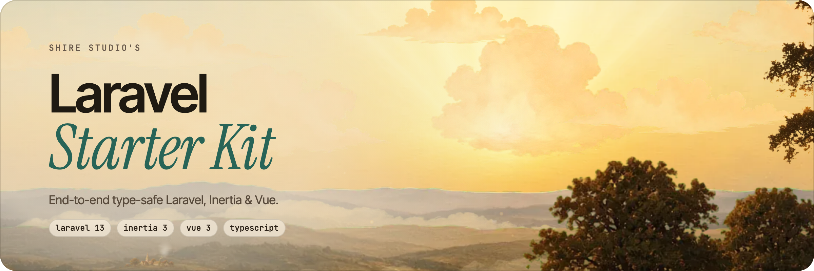

<picture>
    <source media="(prefers-color-scheme: dark)" srcset="art/header-dark.png">
    
</picture>

<br/>
<br/>

<p>
    <a href="https://github.com/shire-studio/laravel-starter-kit-vue/actions"></a>
    <a href="https://packagist.org/packages/shire-studio/laravel-starter-kit-vue"></a>
    <a href="LICENSE.md"></a>
</p>

An end to end type safe Laravel 13 starter kit with auto generated TypeScript types, Vue 3 and shadcn-vue components for fast frontend prototyping. It combines Wayfinder, Laravel Data and unplugin-auto-import to give a Nuxt like developer experience inside a Laravel Inertia application.

The Vue, React and Svelte kits share the same PHP application line for line. Only the frontend changes.

## Tech Stack

**Backend:** PHP 8.5+, Laravel 13, Inertia.js v3, Laravel Fortify, Spatie Laravel Data, Nuno Maduro's Essentials

**Frontend:** Vue 3, shadcn-vue, TypeScript, Tailwind CSS v4

**Type generation:** Laravel Wayfinder (routes and actions) and Spatie Laravel Data with TypeScript Transformer (Data classes and enums)

**DX tooling:** Vite Plus, unplugin-auto-import, vite-plugin-watch

**Code quality:** PHPStan (level max via Larastan), Rector, Pint (PHP and Blade), oxlint, oxfmt, Pest v5 (100% coverage)

## Features

- **Fully type safe end to end:** TypeScript types for routes, actions and Data classes are generated for you
- **Zero config auto imports:** framework APIs, Inertia helpers and composables are auto imported, just like Nuxt
- **Auto regenerating types:** editing `app/Data` or `app/Enums` regenerates the TypeScript types while `composer dev` runs
- **Dark mode and appearance switching:** built in theme support with cookie based persistence
- **Persistent sidebar state:** the collapsible sidebar remembers its state across requests
- **Complete authentication:** login, registration, password reset, email verification, two factor authentication and passkeys via Laravel Fortify
- **Server side rendering:** an SSR entry point is included and ready to run
- **Preloaded assets:** critical CSS and JS are preloaded through Link headers

## Local Development

> **Requires [PHP 8.5+](https://php.net/releases/), [Node 22+](https://nodejs.org/), [pnpm](https://pnpm.io/) and a code coverage driver such as [Xdebug](https://xdebug.org/docs/install).**
>
> SQLite is used by default for the database, sessions, cache and queue.

The recommended way to start a project is the [starter kit CLI](https://github.com/shire-studio/laravel-starter-kit-cli). It works like the `laravel` installer, and it can also bring newer starter kit releases into your project later (see [Keeping Your Project Up to Date](#keeping-your-project-up-to-date)).

Install it globally with Composer:

```bash
composer global require shire-studio/laravel-starter-kit-cli
```

This installs the `shire-kit` command. Make sure Composer's global bin directory is on your `PATH` (run `composer global config bin-dir --absolute` to find it). Then create a project:

```bash
shire-kit new example-app
cd example-app
```

This creates `example-app` from the latest stable release. You'll be asked whether to install and build the frontend with pnpm, and whether to initialise a git repository. Pass `--pnpm` or `--no-pnpm` and `--git` or `--no-git` to skip the questions, or `--force` to overwrite an existing directory.

If you'd rather not install the CLI, `composer create-project` works too:

```bash
composer create-project shire-studio/laravel-starter-kit-vue --prefer-dist example-app
cd example-app
```

Either way, the project gets a `.starter-kit.json` file recording the release it was created from. Commit it, because the CLI reads it to work out which starter kit changes your project hasn't received yet.

Then set it up:

```bash
# Install dependencies, create .env, generate a key, migrate and build assets
composer setup

# Start the server, queue worker, logs and Vite
composer dev
```

Pest browser tests need Playwright: `pnpm exec playwright install`.

## Keeping Your Project Up to Date

Once you've built on the starter kit, you can't just pull in new releases, because your project has drifted from it. The CLI's `update` command handles this. Run it from the root of your project:

```bash
shire-kit update
```

The project must be in a git repository with no uncommitted changes, so everything the update does can be reviewed with `git diff` and undone with `git restore`. It can live inside a larger repository, such as a monorepo.

The CLI compares the release in your `.starter-kit.json` with the latest one and writes the changes to `.starter-kit-update/` (excluded from git). It then hands them to a coding agent of your choice, which merges them into your code, keeps your own changes and fixes anything the update breaks. Claude Code, Codex, Gemini CLI, OpenCode and Cursor are supported, and only the ones you have installed are offered. Pass `--agent=<agent>` to skip the question.

When the agent is done, the CLI shows the changed files and asks whether to mark the project as updated, which bumps the version in `.starter-kit.json`. Nothing is committed for you. Review the changes, run `composer test`, then commit.

A few things worth knowing:

- **Removed features stay removed.** If you deleted part of the starter kit, such as authentication, the update won't bring it back. The CLI can record these in `.starter-kit.json` so future updates remember them.
- **You can skip the agent.** `--agent=none` only prepares `.starter-kit-update/`. Follow `.starter-kit-update/PROMPT.md` yourself or give it to any agent you like.
- **Older projects** without a `.starter-kit.json` can still be updated. The agent works out which release the project started from and asks you to confirm it.

Update regularly. Small, frequent updates are much easier to review than one large jump across several releases. See the [CLI README](https://github.com/shire-studio/laravel-starter-kit-cli#update-an-existing-project) for every option.

## Available Commands

- `composer dev` starts the app with Laravel's `artisan dev` process runner
- `composer transform-types` regenerates the TypeScript types from PHP Data classes and enums
- `composer lint` runs Rector, Pint and Vite Plus and fixes what it can
- `composer test:lint` checks formatting and linting without changing files
- `composer test:types` runs PHPStan and the TypeScript type check
- `composer test:type-coverage` enforces 100% type coverage
- `composer test:unit` runs Pest with the 100% code coverage requirement
- `composer test` runs all of the above
- `composer update:requirements` bumps every PHP dependency to its latest version

## Code Standards

- **Actions oriented architecture:** every operation lives in a single action class under `app/Actions`
- **Cruddy by design:** controllers stick to resourceful methods
- **Immutable first:** data structures favour immutability to prevent unexpected mutations
- **Fail fast:** strict static analysis catches errors before runtime
- **Strict Laravel defaults:** strict models, automatic eager loading and immutable dates via [Essentials](https://github.com/nunomaduro/essentials)
- **AI guidelines:** the rules in `.ai/rules` keep generated code consistent with the rest of the codebase

## Testing

The project uses [Pest](https://pestphp.com) and enforces:

- **100% code coverage:** the suite fails if coverage drops below 100%
- **100% type coverage:** every method, property and parameter is explicitly typed
- **Static analysis:** PHPStan at level max

Run the full suite with:

```bash
composer test
```

## Releasing

Releases are published by the **release** workflow, not from the Releases page. In the Actions tab, run it on `main` with the new version, for example `v1.5.0`.

The workflow writes the version to `.starter-kit.json`, commits it on top of `main`, tags that commit and publishes a GitHub release with generated notes. Every project created from the release then knows which version it started from, which the [starter kit CLI](https://github.com/shire-studio/laravel-starter-kit-cli) uses to update it later. The release commit is only reachable from its tag, so `main` itself never has a `.starter-kit.json`.

## Contributing

This repository is raised by [Hobbiton](https://github.com/shire-studio/hobbiton), which grows every Shire Studio starter kit from shared smials. Please open issues and pull requests there, so a fix reaches every kit.

## License

This project was created by **Shire Studio** under the **[MIT license](LICENSE.md)**.
